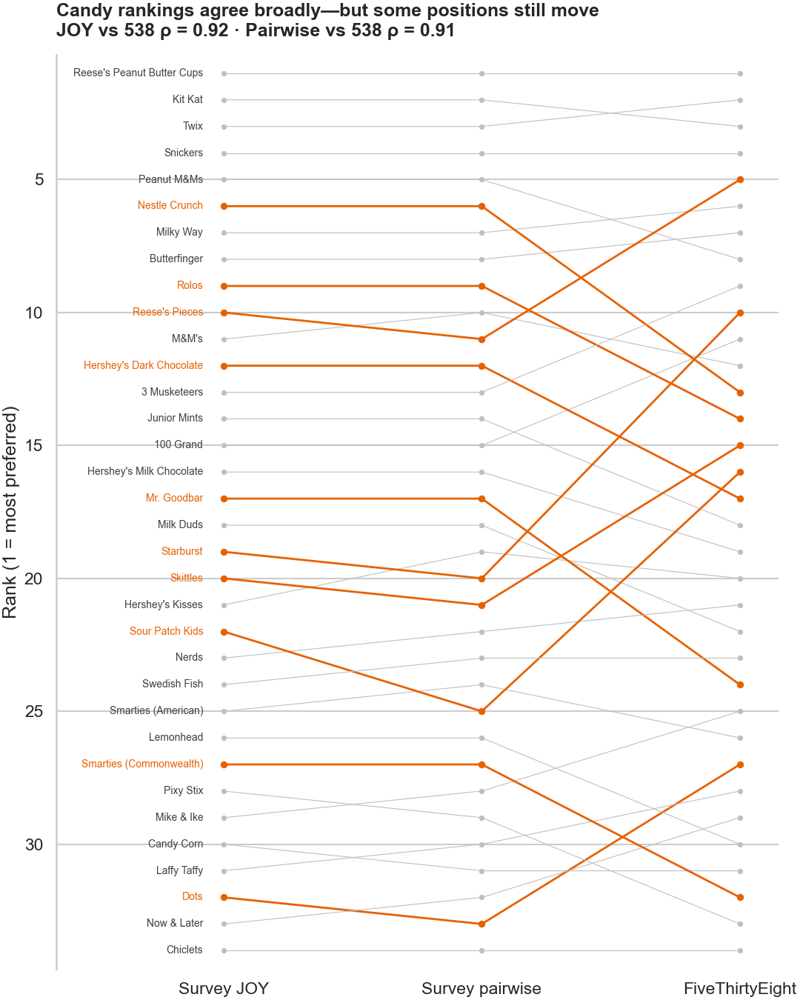
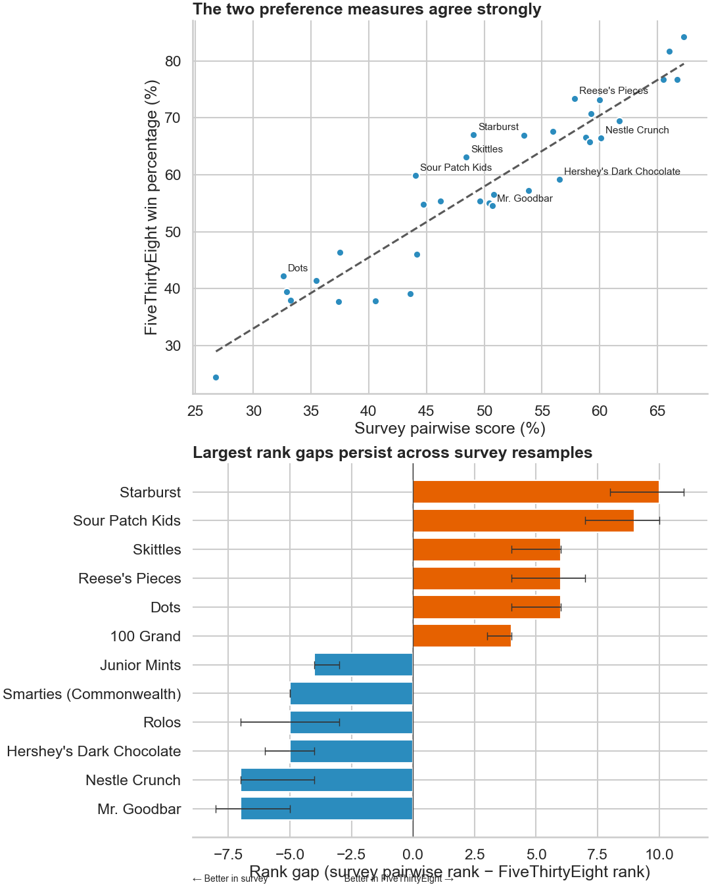
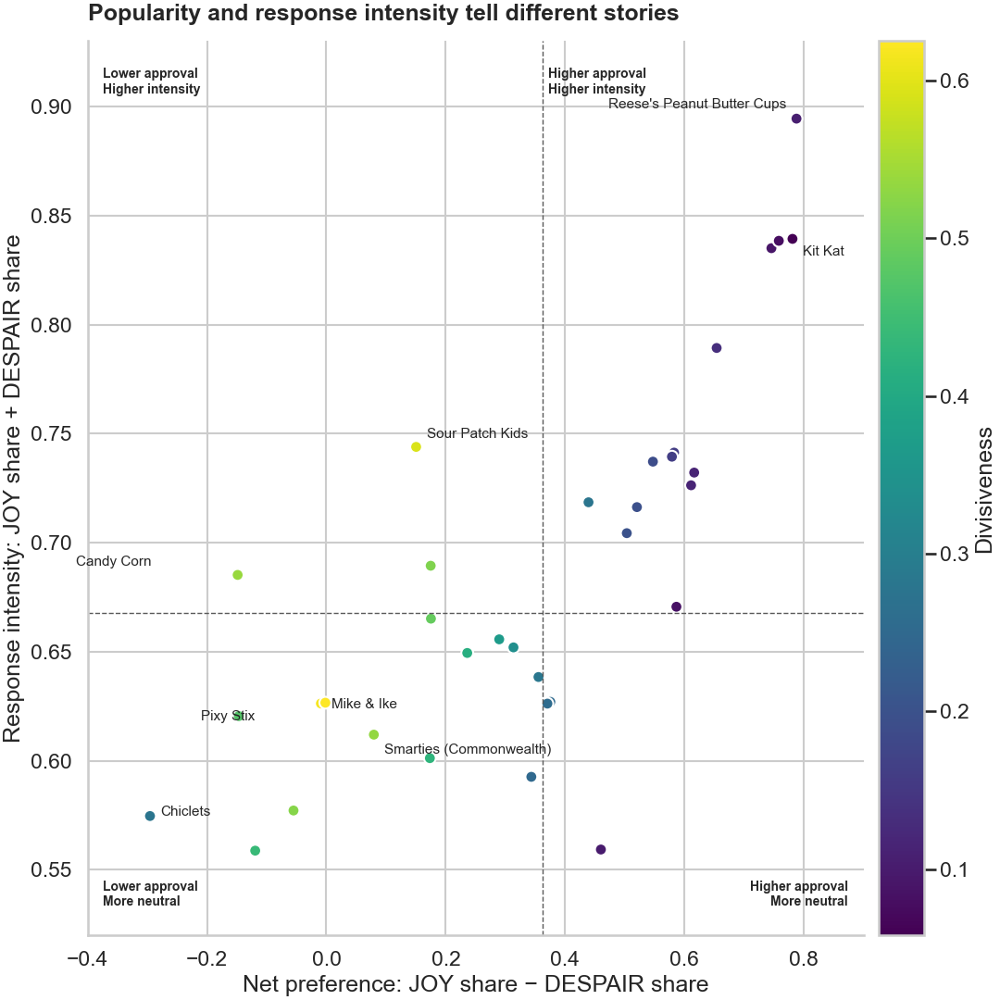

# Beyond the Candy Rankings

How measurement methods and response patterns change our understanding of candy preferences.

This project compares two 2017 candy datasets:

- **Candy Hierarchy 2017:** Survey with respondent-level `JOY`, `MEH`, and `DESPAIR` ratings. [Dataset on Kaggle](https://www.kaggle.com/datasets/mahmoudshogaa/candyhierarchy2017)
- **FiveThirtyEight Candy Power Ranking:** Aggregate head-to-head `winpercent` and product attributes. [Dataset on Kaggle](https://www.kaggle.com/datasets/fivethirtyeight/fivethirtyeight-candy-power-ranking-dataset?select=candy-data.csv)

The analysis uses 34 conservatively matched candies. We have considered the survey's **Hershey's Dark Chocolate** and FiveThirtyEight's **Hershey's Special Dark** as the same product.

## Core analysis

1. Compare the survey JOY ranking, a survey-derived ordinal pairwise ranking, and FiveThirtyEight's ranking.
2. Identify candies with the largest cross-source ranking disagreements.
3. Compare net preference with response non-neutrality (`JOY + DESPAIR`).

The focus of the project is reproducible cleaning, statistical reasoning, clear visual evidence, and honest interpretation.

## How to read the story

The results follow one narrative:

1. **Start with ranking agreement:** Determine whether two different measurement methods produce similar candy rankings.
2. **Examine the exceptions:** Identify candies with the largest, reproducible rank differences.
3. **Explain the response patterns:** Separate overall approval, neutral responses, and genuinely opposing reactions.

> **Interpretation boundary:** All findings are descriptive and conditional on these 34 matched candies, a 2017 survey, and FiveThirtyEight's fixed aggregate ranking. They do not demonstrate product-market fit, predict sales, or validate a recommendation engine.

## Methodology and definitions

- **Valid survey rating:** Exactly `JOY`, `MEH`, or `DESPAIR`. Blank responses remain missing; they are never converted to `MEH`.
- **Valid denominator:** Each candy's JOY, MEH, and DESPAIR percentages use only respondents who provided one of those three ratings for that candy.
- **Survey JOY score:** `JOY ratings / valid ratings`.
- **Ordinal pairwise comparison:** For respondents who rated both candies, `JOY > MEH > DESPAIR`. The higher rating receives one win; equal ratings give each candy half a win. A respondent missing either rating is excluded from that candy pair.
- **Survey pairwise score:** The unweighted mean of a candy's tie-adjusted win rates against the other 33 matched candies. This transforms survey ratings; it is not a direct head-to-head experiment.
- **FiveThirtyEight `winpercent`:** The published aggregate win rate from its candy matchups. It is not the percentage of consumers who like a candy.
- **Ranks:** Rank 1 is best. Ties use the minimum rank.
- **Rank gap:** `survey pairwise rank − FiveThirtyEight rank`. Positive values mean the candy ranks better in FiveThirtyEight; negative values mean it ranks better in the survey.
- **Rank agreement:** Spearman's ρ measures association between rankings.
- **Bootstrap intervals:** 2,000 samples resample whole respondents with replacement, preserving all ratings from each selected respondent. FiveThirtyEight remains fixed.
- **Net preference:** `P(JOY) − P(DESPAIR)`.
- **Response intensity/non-neutrality:** `P(JOY) + P(DESPAIR) = 1 − P(MEH)`. It is not itself a measure of disagreement.
- **Divisiveness:** `2 × min(P(JOY), P(DESPAIR))`, used descriptively to identify candies receiving substantial shares of both opposing responses.

## Current files

- `CandyData.csv` — Original FiveThirtyEight data.
- `CandySurvey.xlsx` — Original Candy Hierarchy survey data.
- `candy_analysis.ipynb` — Complete cleaning and analysis workflow.
- `outputs/figures/` — The three final figures generated by the notebook.

The original input data files are never overwritten.

## Results

The data audit, 34-candy mapping, and three core analyses are complete:

- 59,426 valid ratings across the matched candies.
- 1,801 respondents rated at least one matched candy.
- Survey JOY vs. FiveThirtyEight: Spearman ρ = 0.917; respondent-bootstrap 95% interval [0.899, 0.929].
- Survey ordinal pairwise vs. FiveThirtyEight: ρ = 0.906; interval [0.895, 0.920].
- Survey JOY vs. survey ordinal pairwise: ρ = 0.996; interval [0.991, 0.998].
- Starburst and Sour Patch Kids rank substantially better in FiveThirtyEight, while Mr. Goodbar and Nestle Crunch rank better in the survey; all four rank-gap intervals retain those directions.
- Reese's Peanut Butter Cups has the highest net preference and response intensity.
- Pixy Stix and Mike & Ike have almost zero net preference because JOY and DESPAIR are both common, not because respondents are mostly neutral.

The reconstructed pairwise method does **not** improve alignment with FiveThirtyEight in this sample. That negative result is retained because it directly answers the project's primary methodological question.







## Setup

```bash
python -m venv .venv
source .venv/bin/activate
pip install -r requirements.txt
jupyter lab
```

Run `candy_analysis.ipynb` from top to bottom.

## Important limitations

- The survey was self-selected and humorous; results describe its respondents, not the general population.
- Blank survey ratings remain missing and are never recoded as `MEH`.
- The survey-derived pairwise score transforms ordinal ratings; it is not a direct head-to-head experiment.
- FiveThirtyEight's aggregate file does not contain the original matchup observations, so its full sampling uncertainty cannot be reconstructed.
- Cross-source inference is based on 34 matched candies.

